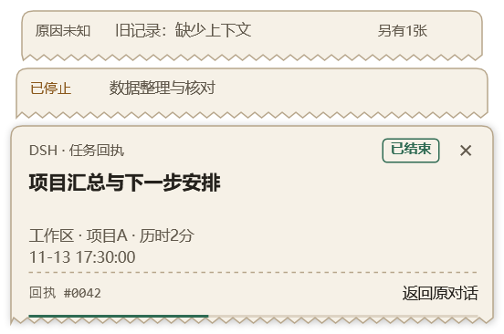
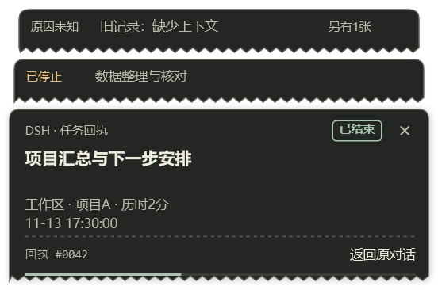

# dsh-finish-reminder

DeepSeek Harness Desktop 的 Windows 任务结束提醒插件。独立原生“任务回执”弹窗、准确返回原对话、待查看计数、通知中心与定时静默。

当前版本：**0.3.1**。修复DSH升级到0.2.2-rc.3后因版本声明被判不兼容的问题。用户已反馈0.3.0任务回执版使用正常；自动检查与人工反馈分别记录，不把反馈扩写为所有测试场景已执行。





上图是无真实对话内容的离屏研发预览，不是用户桌面截图。

## 功能

任务实际结束后，在主显示器右下、任务栏上方显示原生回执，不自动抢占键盘焦点。每条完整前景展示10秒，悬停暂停，队列按FIFO逐条晋升。任务结束、失败、停止、中断、达到限制及受阻使用不同文字。

回执采用纸边、状态印章、上下文和从左向右增长的打印线。点击后保留在途反馈，确认正确窗口与原会话呈现后才减少待查看数；关闭或到期只收起弹窗。临时回执编号不表示成功、历史总数或待查看数量。

待查看数按不同对话去重，任务栏图标采用右上角数字合成；0时撤销自身标记。通知中心逐条保留未查看记录，并保留最近500条已查看/已退休历史。支持时间、工作区、终态及查看状态筛选。

支持15/30/60/120分钟临时静默及每周排程。静默期间保留记录和角标、撤下当前Profile弹窗，解除后不补弹旧记录。工作区与历时仅取宿主元数据，未知信息不补猜。

## 环境

| 项目 | 目标 |
| --- | --- |
| 系统 | Windows 11 x64、底部任务栏 |
| DSH Desktop | 0.2.2-rc.1、0.2.2-rc.3 |
| 原生组件 | 系统 .NET Framework 4.8 WPF |

固定/分组任务栏、窗口绑定、权限变化与异常退出行为以具体环境为准。窗口歧义或前置失败会保留未查看记录，不猜测其他目标。数字呈现范围为1—999，超限明确报错，内部计数保持精确。

## 安装

[下载0.3.1安装包](dist/dsh-finish-reminder-0.3.1.tgz)，并核对[SHA256](dist/dsh-finish-reminder-0.3.1.tgz.sha256)。使用目标Desktop自带的DSH CLI：

```powershell
dsh plugin --profile desktop add https://raw.githubusercontent.com/Xian-JL/dsh-finish-reminder/main/dist/dsh-finish-reminder-0.3.1.tgz
```

也可下载后以本地tgz路径安装。退出旧版实例后升级，再打开DSH，在“设置 → 对话结束提醒”查看通知中心、静默与运行状态。旧配置和记录继续使用，静默排程默认关闭。

运行预构建包不需要编译器。克隆仓库后也可使用安装助手，显式选择本机Desktop目录：

```powershell
node scripts/install-local.mjs --install-dir "D:\Apps\DeepSeek Harness" --profile desktop
```

上例目录需要替换为实际安装位置。安装助手核对包哈希和安装后的版本，只有主动运行安装命令才会修改Profile。

## 开发

```powershell
npm ci --ignore-scripts --no-audit --no-fund
npm run verify
```

verify执行JS及x64原生构建、业务/协议/静默/通知中心与回执测试、独立配色对比度检查、WPF离屏渲染与几何比较，以及运行包白名单检查。Windows GitHub Actions执行相同开发检查。

需要本机DSH的受控宿主加载或确切包加载检查时，指定安装位置：

```powershell
$env:DSH_REMINDER_TEST_INSTALL = 'D:\Apps\DeepSeek Harness'
npm run probe:host
npm run probe:compatibility
npm run package
```

package默认输出dist，包含确切tgz、SHA256和版本/源码绑定；不覆盖可能被本地Profile引用的artifacts旧安装包。probe:host使用实际Cordis与合成服务，不登录、不发送模型任务。probe:compatibility使用当前安装内嵌的semver与Session检查发布包兼容声明、真实SDK事件及历史边界；只声明已核对的rc.1/rc.3，不自动放行其他RC或稳定版。详情见[宿主兼容性](docs/COMPATIBILITY.md)。

lib和native包含预构建组件，helper/ReceiptTheme.g.cs由源码色板生成。修改源码后重新构建和检查产物，再生成dist。首次安装探索、宿主提取文件、Profile备份、沙箱和原始日志不属于公开仓库。

## 数据与权限

不注册模型工具、不调用LLM、不生成提示词、不读取对话正文，不新增托盘或独立任务栏程序。持久数据只保存插件所需的有界标题、身份、终态、时间、上下文和确认水位。

原生输入分类仅保留来源标志和递增序号，不保存按键内容、鼠标坐标或其他应用正文。Profile路由由宿主认证，原生通讯使用本地通道与有界消息。

## 文档

[开发与验收文档](task-receipt-ui-v0.3.0-development.md)、[人工验收清单](MANUAL-ACCEPTANCE.md)、[适配说明](desktop-adapters.md)、[更新记录](CHANGELOG.md)、[仓库与清理约定](docs/REPOSITORY.md)。早期设计保存在docs/history，当前实现优先于历史阶段说明。

源码与产物保留原有权利声明，详见LICENSE；公开仓库不表示自动授予额外分发许可。
