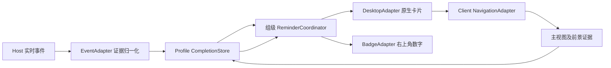

# dsh-finish-reminder 第一版详细设计

设计版本：0.1.0。日期：2026-11-09。依据：本目录 spec.md 1.0.0。

交付性质：可供开发评审的详细设计，尚非可安装插件。本轮没有运行宿主能力探针、修改 DSH 安装文件或真实 Profile，没有执行真机验收。规格中的宿主事实引用自 2026-11-08 基线，本轮没有重新核验其版本与指纹。所有新增接口、消息和模块名均属于本插件内部设计，不代表 DSH 已开放同名能力。

## 1. 设计结论与交付边界

首版采用“DSH Host 适配与持久记录 + 单一提醒协调者 + Client 原生导航确认 + Windows 原生呈现”的本地架构。模型不参与提醒流程。结束记录、弹窗生命周期、已查看边界分别建模；计数从未确认记录集合派生。

完整产品目前存在待验证的工程阻塞：实际 DSH 任务栏图标右上角数字没有已确认可用的实现后端。标准右下角 overlay 不符合需求。G-01 未通过前，仅推进最小能力探针和必要逻辑，不将完整界面、打包或安装视为优先事项，不声明首版完整可用。

本设计不改变 spec.md 的 R-01—R-09。目标为 Windows 11 x64、DSH Desktop 0.2.2-rc.1 基线、底部任务栏；兼容性声明必须以之后的实际验证结果为准。发布到外部平台、创建 Codex/ChatGPT 插件、注册模型工具均不属于此项目。

## 2. 首版决策

| 决策 | 采用方案 | 理由与限制 |
| --- | --- | --- |
| 业务代码 | TypeScript，Host/Client 分离，共享纯逻辑模块 | 便于复用身份校验、协议 schema 和确定性 reducer；运行包包含预构建产物 |
| 原生呈现 | 暂定独立 C#/.NET WPF x64 Helper | 独立于 DSH 页面实现非激活卡片；须先验证 G-04、构建分发体积及原生调用，未通过前不锁定工具链版本 |
| Helper 分发 | 倾向预构建、自包含发布 | 普通用户无需安装开发 SDK；最终运行时版本和许可清单由构建验证确定 |
| 状态权威 | 各 Profile 的 Host Store 保存本 Profile 事实；组协调者负责聚合及展示顺序 | 不把多个 Profile 数据混写进某一个 Profile，不让每个窗口独立覆盖角标 |
| IPC | Host 启动 Helper 通过私有继承管道引导；跨 Host 使用当前用户会话 ACL 保护的命名管道 | 不开放 HTTP 端口；同用户恶意进程不属于本插件能完全隔离的安全边界 |
| 持久化 | 宿主正式存储服务优先，否则在其提供的插件目录内事务写入 | 不推测真实目录；原子替换、落盘确认和损坏恢复能力先探测 |
| 图标后端 | 未选定；以 G-01 探针结果决定 | 不使用右下角 overlay 或修改 app.asar 兜底 |
| 动画 | 默认直接晋升，允许不超过 150ms 的进入效果 | 避免退场动画延长旧卡片点击和阅读时间 |
| 设置 | enabled=true，diagnosticsEnabled=false | 设置加载失败进入 faulted；显式 false 保留 |

WPF 是呈现候选，不承担结束判定、计数增减或导航成功判定。其作为组协调进程时可以托管协调逻辑与 IPC，但持久完成事实仍由来源 Profile 的 Host Store 管理。若能力验证表明需要另一种原生技术，替换 DesktopAdapter 实现即可，业务协议保持不变。

## 3. 分层与数据流



正常结束路径为：实时事件候选、根任务及等待状态关联、提交 Profile 事务、协调者接收并去重、分配 receivedOrder、发布角标和可见队列快照。协调者 receipt 只表示收到展示请求；只有 Profile 存储提交确认才能标为 durable。

导航路径为：接受当前卡片有效点击、弹窗出队并晋升后继、向原 Host/Client 发送导航事务、确认正确前景窗口和真实主视图、持久化有限边界的 ack、重新派生聚合数量。弹窗出队与 ack 没有隐含关联。

Client 设置组件只读取已裁剪状态，调用设置更新和受控诊断入口。Client 重挂载不重建 Host Store 或组协调者。Host 断连时该来源缓存标为 stale，不将其未知数量当作零，也不允许过期路由执行导航。

## 4. 身份、版本与记录

ConversationKey 沿用规格的四元组。序列化采用 schema 校验后的定长字段 JSON 数组或长度前缀编码，禁止直接用冒号拼接。CompletionId 由 ConversationKey、taskEpisodeId、terminalEventSeq 的无歧义编码派生。不得由标题、墙钟、PID 或展示序号构造稳定身份。

hostInstanceId 必须区分“稳定数据来源身份”与“当前进程连接身份”。设计增加 connectionEpoch 表示进程/连接代次；不能在每次重启生成新的 hostInstanceId，导致旧记录失去归属。若宿主没有可持久稳定来源标识，适配层须在正式插件数据命名空间创建并保存来源 UUID，经 Profile 元数据绑定后使用。这一映射在 G-02/G-03 中验证。

| 数据对象 | 关键字段 | 存放及用途 |
| --- | --- | --- |
| CompletionRecord | spec 定义字段；增加 sourceEpoch、streamEpoch、durability | Profile 保存；durability 为运行时附属状态，不把未落盘内容伪装为 durable |
| SourceCursor | sourceId、streamEpoch、liveStart、durableCursor、已接收稀疏区间 | Profile 保存；处理乱序与重连，不能只用最大 seq 丢弃较小但尚未接收事件 |
| ReadBoundary | ConversationKey、streamEpoch、acknowledgedThroughSeq | Profile 保存；仅在相同可比较流内应用水位 |
| PopupEntry | completionId、remainingFrontMs、displayGeneration、state、receivedOrder | 组协调者内存；进程恢复不批量重播 |
| OwnerLease | groupKey、ownerEpoch、ownerToken、processIdentity、leaseDeadline | 组级运行态；防止旧清理覆盖新拥有者 |
| NavigationRequest | requestId、completionId、targetBoundary、route、ownerEpoch、userIntentEpoch、deadline | 请求内存；最多确认点击前捕获的目标边界 |
| CapabilityReport | 宿主指纹、分项能力、verifiedRange、placement、证据引用 | 诊断状态；未知与失败分别表示 |

taskEpisodeId、seq 的定义必须先用实际事件验证。若 seq 在会话重建后会复用，必须引入 streamEpoch；不同 epoch 的 seq 不直接比较。ack 水位只在确认能看到该边界及之前终态时推进。缺少可靠任务边界或呈现边界时，对应能力不通过，不用时间近似补齐。

displayTitle 在入库前去除控制字符并按最多 160 个 Unicode 标量截断；UI 按字形安全省略，不切断代理对。标题只进入记录和当前展示模型，默认日志与诊断日志均不输出标题全文。显示时间为 UTC 时间戳按本地格式展示，排序与计时不用它。

## 5. 结束证据适配

EventAdapter 对外产生内部 NormalizedTerminalFact，包含稳定来源、当前 live 边界、任务身份、终态 seq、终态类别和证据摘要。字段值必须可追溯到源码契约或探针证据。不能把归一化字段当作实际宿主已有字段。

| 内部动作 | 输入条件 | 结果 |
| --- | --- | --- |
| candidate | 当前会话自身实时 turn/end，来源及生命周期可信 | 按任务键暂存候选，不立即弹窗 |
| correlate | 同任务根执行已终止，无自动续跑，非待交互 | 分类后提交事实 |
| defer | 尚有审批/回答/计划确认或同任务续跑 | 保留证据关联，不提交完成 |
| discard | 历史 seed、继承、内部子任务、无任务 no-op | 不提交；可记脱敏原因计数 |
| timeout | 候选等待关联达到初始上限 5 秒 | END_UNCONFIRMED；不得猜测结束 |

候选以两种到达次序产生同一结果：先 turn/end 再根状态，或先根状态再 turn/end。状态快照带来源版本，仅与同一任务关联。超时后若之后收到足够且仍可验证的实时证据，可以重新形成同一 CompletionId 的事实；已提交事实不会再次入队。

终态文案使用 spec 3.2 的固定映射。未识别原因只有在实际终止证据充分时使用“本轮已结束（原因未知）”。running=false、Agent 销毁或静默超过阈值不能独立触发完成。

接入基线采用“订阅同时缓冲 → 获取 live 边界 → 过滤并顺序处理缓冲”的方式；若宿主支持原子订阅游标则优先使用。不能先读快照再订阅留下事件空窗。首次启用、重新启用和连接恢复分别记录基线，停用期间历史不补发。

## 6. Store 事务与计数

Store 对外提供内部 submitTerminal、acknowledge、retire、snapshot、subscribe 方法。所有写入串行化，每次变更先校验来源与预期 revision，再提交新 revision。ack 幂等，目标流和边界必须显式传入。

N 等于活动授权来源中至少有一条 unread 且未退休记录的 ConversationKey 数量。它不是队列长度、结束次数或宿主 completionUnread 大小。聚合时保留完整四元组，不合并不同 Profile 的同名会话或相同 sessionId。

新事实先进入带 pending 标记的内存事务，再尝试持久化。正常路径提交成功后才发布呈现。写入失败保留事实和去重身份，显示 STATE_WRITE_FAILED，禁止向协调者宣称 durable；可发布明确带故障的临时提醒，但能力状态必须为 faulted。重试沿用原事务及 CompletionId，不能重新计数。崩溃前没有落盘的事实不承诺可恢复。

删除或明确归档同时退休记录并撤销该会话尚在展示的卡片；普通释放内存不触发 retire。手动 ack 不必删除仍在队列内的提醒，保持“每次有效结束独立提醒”的语义；只有删除/归档、停用和相应卡片自身操作会强制移除。

持久化包含 schemaVersion、sourceIdentity、revision、records、readBoundaries、dedupeIntervals 和完整性信息。优先宿主事务存储；文件后端使用同目录临时文件、flush、原子替换和受控备份。不要以多个文件的独立 rename 假装跨文件事务。损坏时保留原始文件和可读备份，仅回报分类，不输出正文或擅自覆盖为零。备份回退后必须报告可能缺失区间，不能宣称完整恢复。

跨进程 exactly-once 不作绝对承诺。提交后、投递前崩溃时，通过幂等 outbox 重投；同一协调者代次按 CompletionId 只入队一次。新协调者启动以快照恢复计数、建立 live barrier，不把旧 outbox 当新提醒。barrier 之前的事实仅计数，之后事实入队，边界处以来源 cursor 对齐。这样优先防止重启弹窗洪流，允许故障窗口内提示未完整展示并明确诊断。

## 7. FIFO reducer 与时钟

reducer 接受 TerminalCommitted、Painted、AvailabilityChanged、TimerDue、BodyClick、Dismiss、Retire、RendererLost、Disable 等内部动作。每次输出新状态与副作用描述，副作用完成后再送回带代次的事件。reducer 不直接访问 IPC、文件或系统时钟。

| 当前状态 | 有效输入 | 转换与副作用 |
| --- | --- | --- |
| 空队列 | 新事实 | 排为队首；请求绘制，不提前启动预算 |
| 等待完整绘制 | 匹配卡片及绘制代次的 Painted | 标为 front，启动剩余预算 |
| front | 后续新事实 | 追加 FIFO；只更新最多两张 preview，保留当前 deadline |
| front | 有效 TimerDue | expired，立即撤销命中，晋升下一条 |
| front | 有效正文点击 | opening 并出队；建立导航事务，晋升下一条 |
| front | 关闭 | dismissed 并出队；不确认记录 |
| front | 锁屏/休眠/不可显示 | 结算已展示时间，暂停剩余预算 |
| 暂停或重建 | 新完整绘制确认且环境可用 | 恢复剩余预算，不重给 10 秒 |
| 任意 | 停用/退休 | 撤销相应表面和定时器；持久读状态按各自语义处理 |

每张卡片预算初值 10000ms。预算扣减为有效可见区间的单调时间差。协调者统一时钟域；Helper 原始时钟值不能与 Host 的 performance.now 直接相减。若绘制时间由 Helper 提供，握手先建立时钟映射及误差界限；不能可靠映射时由原生协调进程同时记录绘制与计时。

原生绘制确认表示本代次完整布局已经提交且窗口处于允许的显示环境，不宣称能证明每个像素绝对无遮挡。锁屏/休眠通知需保留事件发生时刻并验证通知延迟；时钟是否包含休眠必须实测。渲染丢失到重绘期间暂停；普通 DSH 被其他应用遮挡不暂停。

定时器只服务当前 front，回调带 cardId、timerGeneration、ownerEpoch。按下与抬起同时匹配 cardId 和 displayGeneration 才能点击；到期先提交则旧点击无效，点击先提交则旧到期无效。preview 和透明阴影均不承接导航动作。

| 独立验收时序 | 预期 |
| --- | --- |
| A@0、B@5000 | A 完整至 10000；B 此前仅预览，完整至 20000 |
| A@0、B@5000、点击 A@7000 | A 出队；B 完整至 17000；A 未获导航证据则仍 unread |
| A/B/C@0 | 按接收顺序各展示 10000ms，总阅读预算 30000ms |
| A front 已展示 4000 后锁屏 | 解锁完整重绘后剩余 6000ms |
| A 点击等待中 A 又结束 | 旧事务最多确认旧边界，新记录继续 unread |

实现使用上述手工预期值作为测试夹具，不能用 reducer 自己生成预期答案。显示状态变化不得重新分配 receivedOrder。

## 8. 原生卡片与几何

前景 336×104 DIP，圆角 12 DIP；最多两层预览，各露出 8 DIP，横向每层缩进 4 DIP。阴影每侧 8 DIP，绘制面距安全区域右、下边各 16 DIP；两预览时为 352×136 DIP。具体坐标公式遵循 spec 6.2。宽度收敛的暂定下限为 280 DIP，须经中文字形及 200% 缩放测量后确定；高度不足先减少预览，仍不可读则 DISPLAY_UNAVAILABLE，保留队列。

单个原生表面承载三层视觉，不创建整屏透明窗口。窗口无独立任务栏和 Alt+Tab 项，不新增托盘。初始显示和晋升走不激活路径，关闭按钮只关闭当前卡片。辅助技术主动激活动作与正文点击进入同一事务。

卡片布局为状态行、最多两行会话标题、时间及返回提示；关闭按钮拥有独立命中区。明暗模式分别定义实色背景、主文字、次文字及状态色，不从任意主题透明度继承。普通正文对比度目标至少 4.5:1，失败/停止始终有文字说明。默认无声音、无全局闪烁。

DesktopAdapter 输出主显示器标识、物理工作区、底部任务栏边界、自动隐藏展开保留厚度及 DPI。逻辑几何只换算一次物理像素；接受负坐标。任务栏展开厚度不能可靠获得时报告能力不足，不能只凭当前隐藏状态把弹窗贴到屏幕底边。

事件优先监听显示器、DPI、主题、会话锁定和 Explorer 变化，按变更局部重算。透明边缘和阴影不吞输入；预览条无导航命中。程序注入点击识别和辅助技术激活都列入 G-04 探针；无法证明输入来源时不把该通路宣称为已符合共存要求。

## 9. 导航与已查看确认

事务 deadline 为 3000ms，阶段耗时独立记录。正文点击后先校验 ownerEpoch、source connectionEpoch、目标权限和会话状态；选择稳定身份映射的窗口、Profile 和 Client，恢复并请求前置，再调用经核验的 uiWorkspace.openSession。该调用返回 void，不是成功凭证。

成功证据必须汇合：真实前景 HWND 与进程创建身份匹配、窗口可交互且未最小化、目标 Profile/sessionId 正在主视图、目标终态边界已经可查看、请求代次有效且用户没有产生更新的导航意图。仅挂载了 session 对象或后台 WebContents 加载完成不够。

requestId 是插件内部关联令牌；不假设原生 openSession 会回传 requestId。Client 在调用前订阅主视图，记录 viewRevision 与 userIntentEpoch，把后续可见证据归属到唯一仍有效事务。若宿主不能区分用户中途导航和本请求结果，应阻止误确认并让 G-03 不通过，不能凭目标相同就假造归因。

手动返回应用、重新选择会话或结束后的真实阅读交互可形成另一类 ViewEvidence，必须发生在该结束之后，并携带当时已呈现终态的边界。结束时已经处于前台的旧状态不能抵消新 unread。边界不可证实时保留 unread。

系统拒绝前置时报告 FOREGROUND_DENIED，不发送模拟按键。目标归档/删除分别报告 TARGET_ARCHIVED/TARGET_GONE 并退休对应记录；权限失效保留诊断且不得改用另一 Profile。失败反馈进入原实例的非阻塞状态区或设置页，不污染下一张卡片。重试必须由新的明确用户动作发起；首版不自动抢回焦点。

## 10. 右上角角标决策与能力状态

BadgeAdapter 的内部契约包含 probe、acquire、renderExactCount、releaseOwnMark、recover。probe 返回 placement、taskbarAppIdentity、verifiedCountRange、ownershipMode、evidenceId；结果未知不能按 supported 处理。

优先探索宿主正式主进程图标服务；其次验证不修改安装文件的图标合成是否实际影响正确任务栏按钮；最后才评估绑定真实按钮的轻量原生角标窗口。每条路线都必须验证固定、分组、基础图标更新、自动隐藏、DPI、Explorer 重启与撤销。位置不能绑定可信 AppUserModelID/窗口映射时停止该路线，不做标题近似识别。

仅有标准右下角 overlay 时回报 BADGE_PLACEMENT_UNSUPPORTED。没有经过 G-01 的 BadgeAdapter 默认不可取得图标写入所有权，不向真实任务栏尝试宣称达标的呈现。数字范围至少实测 0、1、2、9、10、99、100；超过后端验证范围精确保留内部 N，并报告 BADGE_RENDER_LIMIT，禁止悄悄改为 99+。

| 设置页状态 | 派生条件 |
| --- | --- |
| initializing | 配置、存储或关键探测尚未完成 |
| supported | 结束、原生弹窗、导航、右上角角标均有有效能力证据，且无阻塞存储/生命周期故障 |
| badge-unavailable | 角标缺失或位置/范围不满足；显示具体错误 |
| navigation-unavailable | 无法可靠定位或确认目标主视图/前景 |
| popup-only | 结束与弹窗可用，但导航、角标均未就绪；仅作为明确诊断模式 |
| faulted | 事件来源不可信、设置/存储/协议损坏、资源容量或隔离失败 |

禁用为独立 enabled=false 展示，不强行塞入能力枚举。多个故障并存时保留分项结果，主状态优先 faulted，其后 initializing、navigation-unavailable、badge-unavailable；两项皆不可用但弹窗可用时显示 popup-only。supported 只表示当前验证环境内的能力就绪，不能替代整版验收通过。

## 11. IPC、协调所有权与重连

消息包固定包含 protocolVersion=1、nonce、ownerInstance、ownerEpoch、requestId、revision、generation、type、payload。Host→Helper 单帧最多 128KiB，反向最多 32KiB，按 UTF-8 字节计算；读取端在完整分配 payload 前限制帧长。JSON 中非有限数、未知动作、超长文本、错 nonce、错所有者和过期代次明确拒绝。

| 消息类别 | 允许负载 | 确认语义 |
| --- | --- | --- |
| hello / capabilities | 协议版本、可信来源、能力摘要 | 只表示握手，不形成结束 |
| syncView | 精确 N、当前前景及最多两预览、主题、剩余预算 | revision 不变时幂等，不启动新卡片预算 |
| painted / availability | 卡片及显示代次、环境可见状态 | 仅匹配当前代次才影响时钟 |
| bodyClick / dismiss | cardId、displayGeneration、激活来源类别 | Host/协调者重新校验，不接收任意导航目标 |
| close / shutdown / ack | 本所有者表面/资源标识、受控状态 | 仅清理本代次所有权 |

各 Host 与组协调者之间另用内部 registerSource、sourceSnapshot、terminalCommitted、ackDelta、unregisterSource 消息，受相同身份与长度约束。来源快照不含对话正文，超限时分页并带 snapshotRevision 和结束校验；分页完成前不发布部分集合为完整 N。原生呈现端只收到当前三张卡片需要的元数据，不收到历史队列或全部 Profile 记录。

组键由 Windows 登录用户会话与经过验证的实际任务栏分组身份构成。命名互斥体选出单一协调者；管道 ACL 与进程创建时间绑定来源。租约初始设计为 2 秒心跳、6 秒失联判定，均属待故障测试参数。租约到期必须配合互斥体实际释放和旧呈现退出，不能只按时间启动第二个角标写入者。无法排除旧拥有者存活时进入 BADGE_OWNER_CONFLICT。

Helper 不随第一个 Host 退出就杀死全部服务；其生命周期由所有已授权活动来源的租约集合决定。最后来源退出时立即清理；进程异常退出则在失联上限内释放。Client 不计为独立完成来源。PID 复用不能续租旧来源。

响应经过完整校验后才删除 pending；畸形响应不使原 Promise 丢失。普通请求初始超时 2 秒，能力探针按各自用例期限，导航总期限 3 秒。超时、取消、通道损坏和退出都必须 settle pending。IPC 不接受脚本、可执行路径、任意 URL、键鼠输入或文件操作指令。

## 12. 恢复、容量与资源归属

启动时先加载设置和 Store，再建来源基线与协调者连接。正常重启仅恢复 unread 数量与去重状态，不重放旧弹窗。Helper 重建后根据当前协调者内存恢复仍有效卡片和剩余预算；若协调者本身丢失，则按新启动边界恢复计数并记录展示中断，不猜测旧卡片显示了多少秒。

暂定软限制为每 Profile 10000 条活动未确认记录、聚合待展示队列 10000 条、单 Profile 状态 16MiB。它们是工程预算，不是允许丢事实的规则。接近阈值提前报告；达到阈值时保留已有状态和能保存的新事实，进入 QUEUE_CAPACITY_ERROR，明确后续收集/展示可能不完整。恢复完整服务必须校验丢失边界或由用户知情重新建立实时基线，不能悄悄清空记录。

已确认记录仅在去重 cursor/稀疏区间已持久覆盖后压缩。未确认事实不能为了容量被裁剪。来源断连缓存保留 stale 标记和最后有效数量；设置页同时显示数量未知/过期状态，不能用过期聚合宣称精确实时计数。

| 资源 | 创建者 | 释放触发 |
| --- | --- | --- |
| 事件订阅、候选关联定时器 | Profile Host | 停用、来源销毁、代次变化 |
| Store 写入队列 | Profile Host | 完成已开始的受控提交，再结束生命周期 |
| 组互斥体、管道、心跳 | 协调者 | 最后来源退出、故障或卸载 |
| 卡片、图标令牌、当前 deadline | 协调者/原生适配 | 停用、退休、到期、失去所有权 |
| 主视图监听、导航事务 | Client Adapter | 成功、失败、超时、用户新意图、Client 卸载 |
| 设置页订阅 | Client 组件 | 卸载；不清空 Host 完成记录 |

所有清理按 ownerEpoch 和资源令牌核对；旧 finally 不得清除新请求。停用保留已有 unread 元数据，停止新事件采集并撤销自身卡片和角标；重新启用恢复计数，使用新 live 基线。其他插件的开关、状态、图标和输入能力均不修改。

## 13. 开发前能力探针

所有探针初始状态均为 NOT_RUN。本设计中的预期结果不是测试证据。应先运行 G-01 最小验证，失败后形成阻塞结论，再决定是否继续其余受控开发。

| 关卡 | 最小探针及需要采集的证据 | 通过标准 | 不通过处理 |
| --- | --- | --- | --- |
| G-01 | 只读核对宿主正式桥；在实际 DSH 按钮测试候选后端的 0/1/2/9/10/99/100，记录按钮身份、坐标、DPI、固定/分组/自动隐藏及 Explorer 重建结果 | 数字处于真实图标右上角，精确可读，0 和退出可撤销，所有权不覆盖其他来源 | BLOCKED；记录 BADGE_*，不以右下角替代 |
| G-02 | 无敏感测试任务分别产生正常、失败、停止、等待、续跑、fork、内部子任务和恢复事件，仅保留字段映射与脱敏时序 | 能证实自身实时根任务边界，前后台一致且无重放误报 | 修订 EventAdapter，不使用 idle 猜测 |
| G-03 | 两个测试会话、改名、关闭标签、多 Profile/窗口，插入用户中途切换及目标缺失 | 3 秒内正确主视图与前景证据汇合；旧响应不确认新边界 | navigation-unavailable；保留 unread |
| G-04 | DSH 最小化且其他应用有焦点；A/B 相隔 5 秒，锁屏恢复、DPI 变化、自动隐藏及注入点击/辅助激活 | 原生右下安全区，弹出不激活，各 10 秒预算，点击源和命中有效 | DESKTOP_BRIDGE_UNAVAILABLE 或具体故障 |
| G-05 | 20 次启停、100 次展示、Helper 死亡、多 Host 退出与重连 | 无资源线性增长，无双所有者和旧回调复活，不影响其他插件 | faulted，不进入完整发布 |

探针记录 probeId、源码/宿主指纹、环境、输入事件摘要、观察时间线、预期、实际、状态、证据路径与失败原因。真实任务栏、窗口和导航证据不可由离屏图替代。需要重启 Explorer 的用例须先保存可恢复测试环境，并在专门真机验收阶段执行，本轮设计没有执行这些操作。

当前需要落实的宿主映射为：根任务及续跑字段、实时序列与 epoch、稳定 Profile/实例身份、正式插件数据目录、主视图订阅及用户导航意图、窗口 HWND/进程映射、可用桌面桥、角标所有权及基础图标变更服务。每项必须附实际包路径与指纹；找不到就报告缺口，不创造 SDK 名称。

## 14. 工程结构与阶段交付

以下为后续实现结构，不代表本轮已创建对应代码。

```text
dsh-finish-reminder/
  spec.md
  design-v0.1.0.md
  package.json
  cordis.patch.yml
  src/shared/   identity, schema, outcomes, reducer, clock, settings
  src/host/     event-adapter, store, outbox, coordinator-client, lifecycle
  src/client/   navigation-adapter, view-evidence, settings-page
  helper/       coordinator, ipc, popup, geometry, badge-backend
  scripts/      probe-*, build, inspect-package
  tests/        fixtures, unit, integration, fault-injection
  evidence/     脱敏探针与验收记录，不进入运行包
  lib/          预构建 Host/Client 产物
  native/       已核验 x64 呈现组件
```

阶段 A 先交付 G-01 决策和全部宿主映射表。角标不可行时，正式输出完整产品受阻的工程报告；可以继续结束/弹窗的受控验证，但不得生成“完整可用”发布记录。

阶段 B 实现共享 schema、身份、reducer、Store 与独立预期夹具，通过计数、FIFO、乱序、去重、ack 竞态、持久化失败和代次测试。阶段 C 接入已验证的 Host/Client/Helper 和角标后端，通过 G-02—G-05。阶段 D 运行 spec 第 14 节全部适用用例及最小人工闭环，记录未运行项与限制，然后构建确切运行包并解包验证。

实际 dsh.bundle、Client 入口、外部依赖及 cordis patch 只在核对目标宿主后填写。package files 白名单限定运行产物、必要元数据和许可证；不包含测试、证据、源事件、私有配置或绝对工作区路径。安装预构建包后做包内加载测试，绑定源码提交、spec 版本与 SHA256。不得复用另一插件的版本、测试结论或发布状态。

## 15. 要求覆盖与设计验收

| 要求 | 本设计落点 | 实现验收来源 |
| --- | --- | --- |
| R-01 每次实际结束提醒 | 第 4—7 节，实时边界、任务事实、去重和前后台统一处理 | EVT-01—11 |
| R-02 点击返回原对话 | 第 4、9、11 节，稳定身份、前景/主视图证据、有限 ack | NAV-01—07、CNT-04—06 |
| R-03 实际图标右上角数字 | 第 10、13 节，G-01 准入及精确聚合 | BADGE-01—07、DATA-02 |
| R-04 零时不显示 | 第 6、10、12 节，集合派生与仅释放自身标记 | BADGE-01、LIFE-02 |
| R-05 主屏右下任务栏上方 | 第 8 节，安全区域与 DPI 换算 | GEO-01—04、POP-08 |
| R-06 小型圆角矩形 | 第 8 节，336×104 DIP 与受限收敛 | POP-09、GEO-01/04 |
| R-07 完整前景 10 秒 | 第 7 节，可控单调时钟及锁屏暂停 | POP-01—07 |
| R-08 后来者在后 | 第 7、8 节，FIFO、一前景两预览 | POP-03/04/10 |
| R-09 移除后自动晋升 | 第 7、9 节，单一 reducer 串行转换 | POP-01/02/05、NAV-07 |

其余横向约束对应 LIFE-01—05、DATA-01/02、PKG-01/02，必须随实现独立验收。性能目标沿用 spec 11.3；事件提交、绘制、角标更新、导航发起和导航成功分别计时。

本设计交付标准为：模块边界、数据归属、事件资格、FIFO 时钟、导航证据、原生呈现、角标准入、恢复和失败处理都有明确实施路径，并且未知能力有明确探针与停止条件。本轮达到详细设计交付范围；G-01—G-05 与 spec 第 14 节实现验收仍全部为 NOT_RUN。
